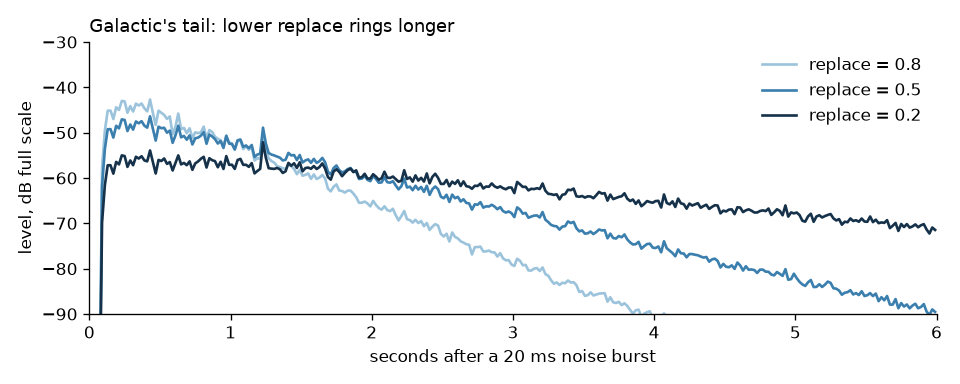

airwindows-py brings Chris Johnson's Airwindows plug-ins, 528 of them, to
audiodsp's audio graph on CPython and MicroPython-compatible firmware.

## Install

On CPython, beside [pydevices-audiodsp](https://pypi.org/project/pydevices-audiodsp/) 0.6.10 or later:

```sh
pip install git+https://github.com/bdbarnett/airwindows-py
```

On MicroPython, build this repository into the firmware next to audiodsp
0.6.10 or later: [Install](docs/get-started/install.md) has the command.

## Try it

```python
from array import array
import audiocore, audioairwindows

RATE = 48000
noise, x = array("h"), 1
for _ in range(RATE // 50):
    x = (x * 1103515245 + 12345) & 0x7fffffff
    noise.append((x >> 16) % 20001 - 10000)

verb = audioairwindows.Galactic(sample_rate=RATE, channel_count=1, replace=0.3)
verb.play(audiocore.RawSample(noise, sample_rate=RATE, channel_count=1))
for row in range(12):
    loudest = 0
    for _ in range(48):
        block = array("h", bytes(audiocore.get_buffer(verb)[1]))
        loudest = max(loudest, max(abs(v) for v in block))
    print("%.2f s  %5d" % (row * 48 * 256 / RATE, loudest))
```

It prints the loudest sample of each quarter second or so, the same on
CPython and MicroPython:

```
0.00 s    247
0.26 s    343
0.51 s    307
0.77 s    243
1.02 s    325
1.28 s    203
1.54 s    194
1.79 s    194
2.05 s    155
2.30 s    144
2.56 s     86
2.82 s     92
```

[Docs](docs/index.md) · [Examples](examples/) · [Roadmap](ROADMAP.md)

The effects are Chris Johnson's [Airwindows](https://github.com/airwindows/airwindows), MIT licensed; [NOTICE](NOTICE) says what came from where.

OmniPython is made by [PyDevices](https://pydevices.com).
